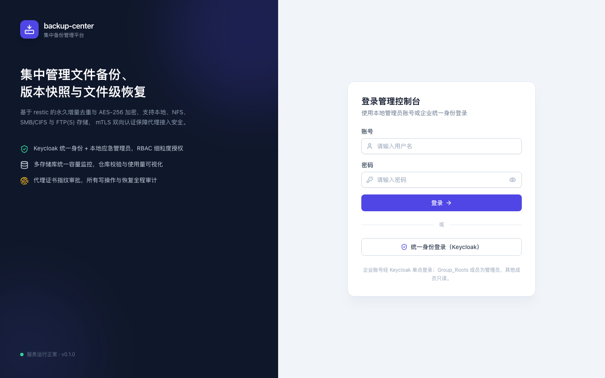
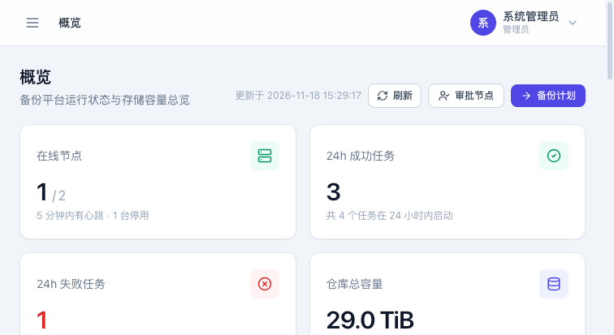

# backup-center — 集中式文件备份平台

> 部署主机：`172.16.50.150`（`eda.tri.local`）
> 访问地址：**https://backup.tri.local**（旧域名 `https://eda.tri.local` 兼容）
> 代码仓库：https://git.tri.local/it/backup.git（保护分支 `main`；同步：`scripts/sync-gitlab.sh`）

## 能力

- Web 集中管理：节点审批接入、目录/文件选择、备份计划、快照版本、文件级恢复、审计、告警
- 代理模式：Linux（systemd）/ macOS（launchd），只出站，mTLS 双向认证
- 引擎：restic 0.18.0（首次全备 + 永久增量去重、zstd 压缩、AES-256 加密、快照保留）
- 数据面：Node 内置 restic REST 协议（mTLS + append-only + 每个节点独立仓库）
- 存储位置：本地目录 / NFS / SMB(CIFS) / FTP(S)；一个节点可加入多个备份池
- 身份：Keycloak SSO（`Group_Roots`=管理员；其他域账号需预置角色 operator/viewer/auditor 才能登录）+ 本地应急管理员

## 目录

```text
docs/架构.md      架构与接口契约（先读）
server/           Node 24 零依赖管理端
agent/            Go 备份代理
ui/               Vue 3 前端（构建到 server/public）
deploy/           systemd、安装脚本、挂载助手、二进制分发清单
scripts/          构建/验收/巡检脚本
```

## 开发

```bash
# 服务端（无需 npm install）
node server/src/main.mjs --config server/dev/config.json
node --test server/test/

# 前端
cd ui && npm ci && npm run dev       # /api 代理到 http://127.0.0.1:9443
npm run build                        # 产物到 ../server/public

# 代理
cd agent && go test ./...
../scripts/build-agent.sh
```

## 项目文档

| 文档 | 内容 |
|---|---|
| [项目文档](docs/项目文档.md) | 总览、架构、部署信息、权限、保留/恢复、验收摘要 |
| [架构](docs/架构.md) | 组件、数据模型、API/Agent 契约 |
| [部署手册](docs/部署手册.md) | 构建、安装、节点接入、SSO、升级 |
| [运维手册](docs/运维手册.md) | 服务、巡检、故障排查、告警 |
| [用户手册](docs/用户手册.md) | 登录、审批、计划、快照、恢复、保留策略 |
| [BCP 业务连续性](docs/BCP.md) | 服务分级、RTO/RPO、3-2-1-1-0、故障处置、演练与替代方案 |
| [恢复手册](docs/恢复手册.md) | 文件级/单机/控制面/仓库/密钥故障的实操恢复步骤 |
| [灾难恢复](docs/灾难恢复.md) | 主密钥托管、仓库副本、重建与演练 |
| [Keycloak 接入参数](docs/Keycloak接入参数.md) | client/claim/角色映射 |
| [验收报告](docs/验收报告.md) | 测试用例与结果 |
| [变更记录](CHANGELOG.md) | 版本与修复记录 |

## 部署

生产地址：`https://backup.tri.local`，详细步骤见[部署手册](docs/部署手册.md)。

## 界面





## 版本

| 组件 | 版本 |
|---|---|
| restic | 0.18.0 |
| rclone（仅 FTP 后端） | 1.76.0 |
| Node | 24.18.1（本机复制，不用 dnf） |
| Go | 1.27+（仅构建期） |
