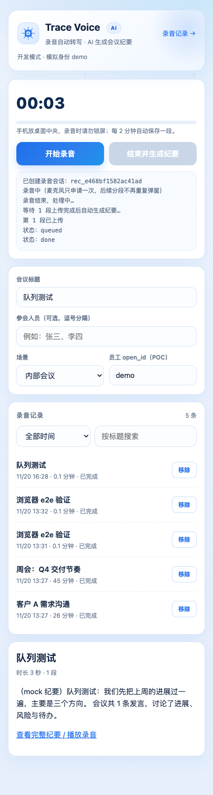
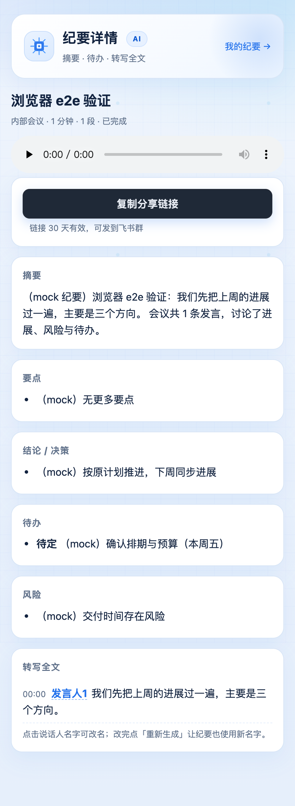
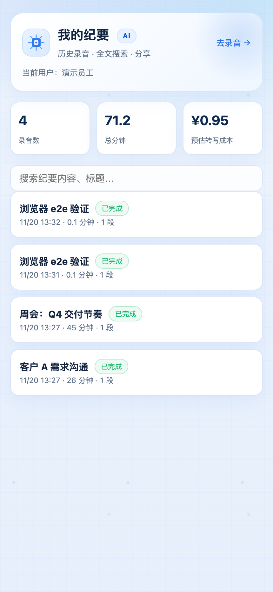
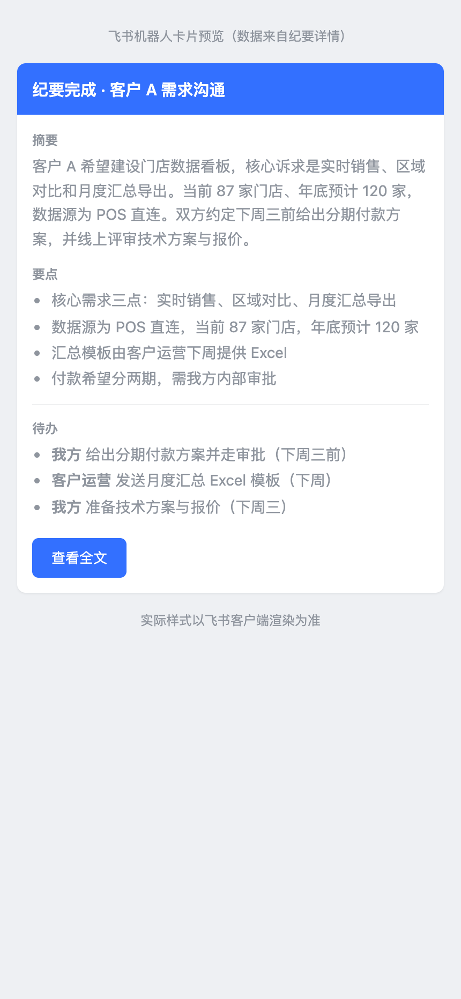

# Trace Voice · 飞书录音纪要

在飞书工作台打开一个**网页应用**，手机录音（30–90 分钟会议，2 分钟一段自动落盘上传），1–5 分钟后拿到带时间戳、发言人分段、待办的结构化纪要，推送飞书群、回调公司网站、可选邮件发送。

> 入口用**网页应用（H5）**而不是小程序——飞书官方已将小程序标记为"不再升级迭代、推荐网页应用"，且新企业可能无法创建小程序入口。详见 [ADR-001](docs/04-技术决策记录.md)。

## 现在能跑什么

本地 mock 模式（无需任何凭据）即可跑通：**录音 → 分段上传 → 合并 → 转写 → 纪要 → 飞书卡片（落盘模拟）→ 签名音频播放**。

```bash
cd backend
FM_SYNC_PIPELINE=true ../.venv/bin/python -m uvicorn app.main:app --port 8000
# 打开 http://127.0.0.1:8000/
```

- 录音页：`/`（WAV 编码、2 分钟自动分段、断点重传、飞书免登；默认标题 日期-时间-人员）
- 录音记录：首页「录音记录」区块（时间筛选、标题搜索、移除），`/mine` 自动跳转到这里
- 分享链接：详情页「复制分享链接」→ `/s/<id>?exp&sig`，群成员无需登录可看（30 天有效）
- **必须登录飞书**：生产模式所有录音接口要求飞书免登会话，未登录返回 401；页面显示登录提示
- 商务淡蓝主题 + AI/芯片元素（`web/theme.css`）
- 说话人改名：详情页点「发言人1」改成真实姓名，可重跑纪要；映射持久化
- 全文搜索：`/mine` 顶部搜索框，检索标题/转写/纪要
- 本地音频上传兜底：wav/m4a/mp3/webm，服务端 ffmpeg 转 16k 单声道 WAV
- 详情页：`/d/{id}`（摘要/要点/待办/全文/音频播放）
- API 文档：`/docs`（FastAPI 自动生成）
- 测试：`cd backend && ../.venv/bin/python -m pytest -q`（51 个用例）
- 浏览器 E2E：`cd backend && FM_E2E_BASE=http://127.0.0.1:8777 ../.venv/bin/python tests/e2e/test_recorder_browser.py`

## 界面一览

| 录音 | 纪要详情 |
|---|---|
|  |  |

| 我的纪要 | 飞书卡片（预览） |
|---|---|
|  |  |

> 首次接入前先跑 `cd backend && ../.venv/bin/python scripts/doctor.py`，它会告诉你还缺什么凭据。
>
> 截图用 `backend/scripts/seed_demo.py` 的虚构数据生成，可重跑：
> `python scripts/seed_demo.py --reset` 后 `python tests/e2e/capture_screenshots.py`。

## 文档

| 文档 | 内容 |
|---|---|
| [需求与方案 v0.2](docs/01-需求与方案.md) | 需求画像、架构、功能清单、选型、成本、里程碑 |
| [飞书应用配置清单](docs/02-飞书应用配置清单.md) | 自建应用创建、scope、发布流程 |
| [技术决策记录](docs/04-技术决策记录.md) | 7 条 ADR，含官方文档证据链接 |
| [POC 计划](docs/05-POC计划.md) | 先验证什么、怎么验证、需要什么素材 |
| [开发与部署](docs/06-开发与部署.md) | 本地运行、测试、切真实服务、Docker 部署 |
| [上线验收清单](docs/07-上线验收清单.md) | 应用/服务端/真机/质量/运维/安全 逐项勾选 |
| [员工使用说明](docs/08-员工使用说明.md) | 一页版：怎么用、录音贴士、隐私、FAQ |
| [部署记录](docs/09-部署记录.md) | 服务器布局、systemd、SELinux、HTTPS 待决策 |

## 结构

```
backend/app/           FastAPI 服务
  api/                 录音会话 / 分段上传 / 签名媒体
  asr/                 转写适配器（mock / 腾讯云）
  llm/                 纪要生成（mock / DeepSeek）
  feishu/              应用机器人卡片
  pipeline.py          合并 → 转写 → 纪要 → 分发
web/                   H5 录音页、详情页
deploy/                Caddy 配置
docker-compose.yml     api + postgres + caddy
```

## 命令行工具

```bash
cd backend
# 直接对本地音频跑转写，输出文本 + 耗时/成本（mock 或 tencent）
../.venv/bin/python -m app.asr.cli /path/to/meeting.m4a --provider tencent --json out.json
```

## 当前状态

- 需求：3 轮问答已对齐
- 选型：已定稿（v0.2）
- 生产：**https://voice.traceic.com:5266**（Let's Encrypt 正式证书），真实阿里云 ASR+LLM 链路验证通过
- POC：后端全链路已跑通（mock）；浏览器真实录音 E2E 已通过（Chromium 假麦克风）
- 队列：DB worker 串行处理，重启不丢任务；音频 90 天自动清理
- 分发：飞书卡片、飞书云文档（自动创建并转交给员工本人）、网站回调（HMAC）、邮件 SMTP
- 事件：飞书长连接消费者（`feishu-events` 服务），群里 @机器人 发「录音」即回应用入口
- 兜底：手机系统录音 App 录的 m4a 可直接上传（已用真实 m4a 验证）
- 断点续录：刷新/中断后页面提示「继续录音」，已上传段落不丢（E2E 验证）
- 弱网优先录音：上传失败不打断录音，分段进入队列自动重试，联网后自动补齐再生成纪要（E2E 验证）
- 麦克风只申请一次：整场录音复用同一个音频流，不再每 2 分钟重新弹权限
- 登录失效：检测到 401 自动静默重登，失败时弹出可点击「登录飞书」按钮
- 录音页：麦克风电平条、屏幕常亮（Wake Lock）、权限错误中文提示
- 分享：签名只读链接 + 卡片转发到指定会话（`POST /recordings/{id}/send`）
- 下一步：飞书应用 + 腾讯云 ASR 凭据到位后真机联调
