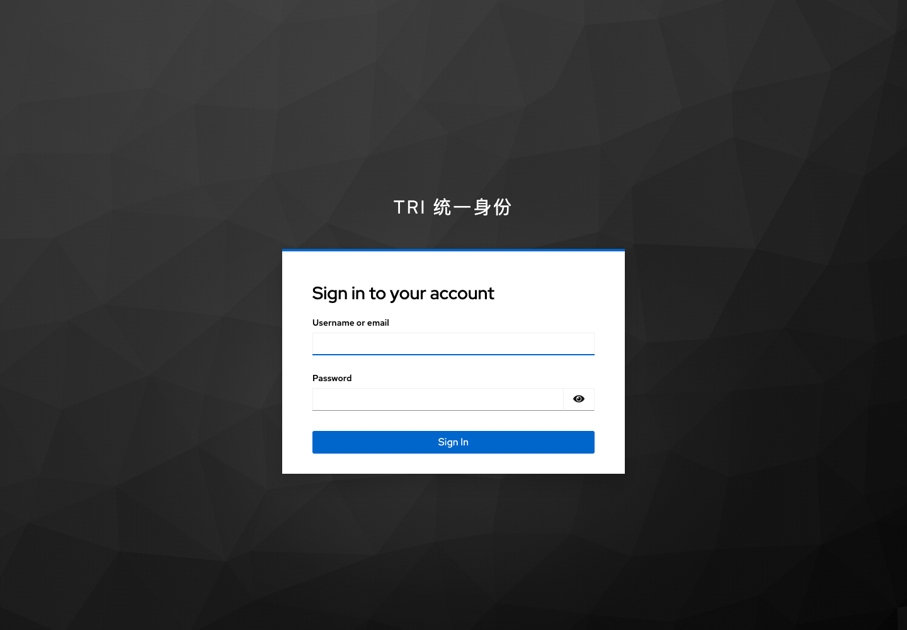
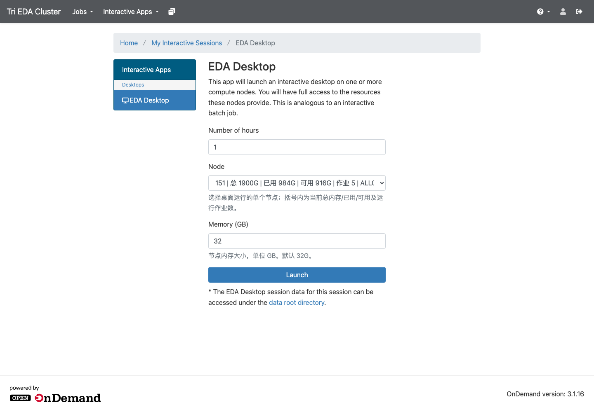
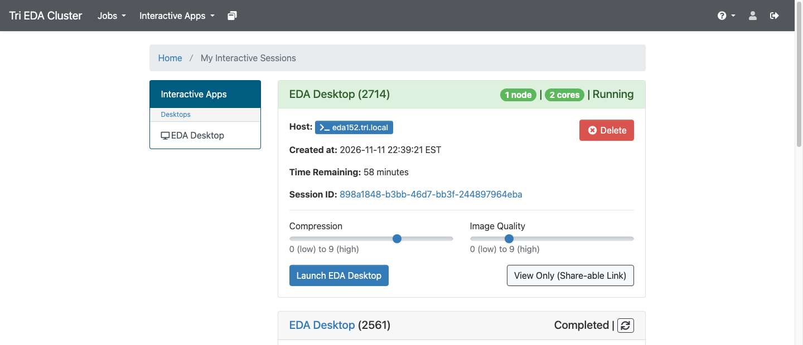
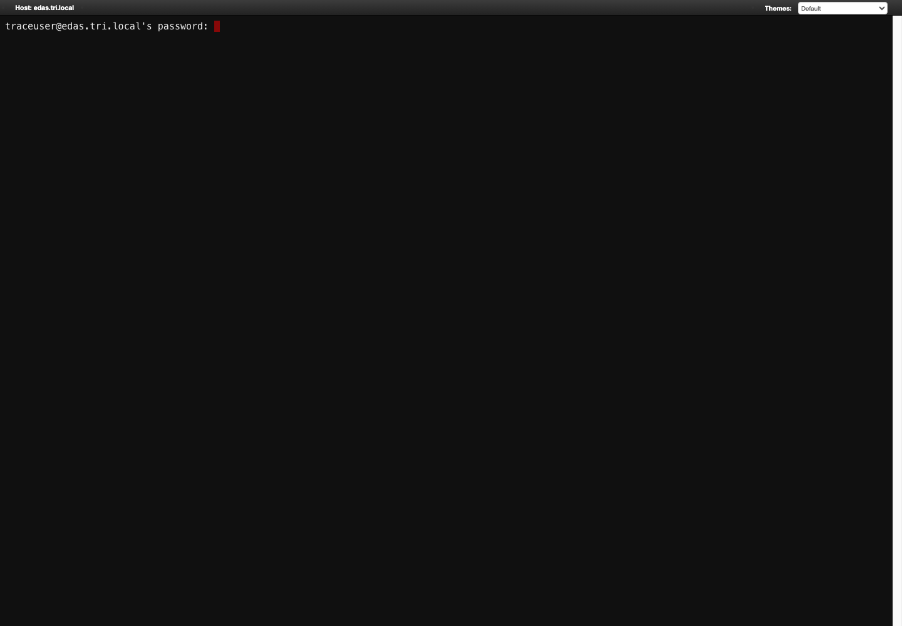

# Slurm 与 OOD 用户操作手册

> 适用集群：Tri EDA Cluster ｜ Slurm 20.11.9 ｜ Open OnDemand 3.1.16  
> 更新：2026-11-13 ｜ 维护：集群管理员

---

## 1. 两个系统分别是什么

### 1.1 Slurm：作业调度系统

Slurm 负责管理计算节点和排队运行作业。

主要能力：

- 统一排队，按资源分配节点
- 支持单节点、多节点、作业数组
- 支持交互式作业（srun / salloc）
- 记录作业历史、资源使用（sacct）
- 支持 EDA 批处理、仿真、综合等长任务

当前资源：

| 分区 | 节点 | 默认 | 说明 |
|---|---|---|---|
| eda15x | 172.16.50.151-155 | 是 | 5 台大内存节点，各 1900G |
| eda | 172.16.50.131-133、150 | 否 | 兼容老节点 |

> 新作业不指定分区时，默认进入 **eda15x**。

### 1.2 OOD：浏览器图形门户

Open OnDemand（OOD）是 Slurm 的 Web 门户，提供：

- 浏览器登录（统一身份 SSO）
- **EDA Desktop**：浏览器里的 VNC 图形桌面
- **Web Shell**：浏览器终端，直接提交 sbatch
- Jobs：查看活动作业、历史作业
- 不需要在本地安装 VNC、X Server 或 EDA 图形环境

| 需求 | 用哪个 |
|---|---|
| 命令行、批处理、仿真 | Slurm（ssh / sbatch） |
| EDA 图形界面、多窗口 | OOD EDA Desktop |
| 不想配置本地 SSH | OOD Web Shell |

---

## 2. 如何登录

### 2.1 公司内网：直接访问 OOD

浏览器打开：

    https://edas.tri.local

会自动跳转到统一身份：

    https://sso.tri.local

输入 **AD 域账号 / 域密码**，登录后进入：

    Tri EDA Cluster

### 2.2 VPN 场景：先登录堡垒机

VPN 环境下如果无法直接打开 edas.tri.local，按以下方式进入：

1. 浏览器登录堡垒机 Web 控制台
2. 左侧导航点击 **运维**
3. 用户配置选择 **根目录**
4. 在资产列表中找到 131 / 132 / 133
5. 在 **访问** 列点击 **SSH**
6. 如果未配置账号，手动输入自己的域账号和密码

登录后确认：

    hostname
    whoami

> 131/132/133 是登录/提交节点，不要在它们上面运行大型 EDA 任务。  
> 作业应通过 sbatch / srun 提交到 151-155 计算节点。

### 2.3 VPN 下使用 OOD 网页

如果 VPN 只能到堡垒机、不能直接访问 edas.tri.local，可使用 SSH 隧道/代理：

方式一：SSH SOCKS 代理（如果本地能 ssh 到 131）

    ssh -D 1080 <你的账号>@172.16.50.131

然后在浏览器中配置 SOCKS5 代理：

    127.0.0.1:1080

再访问：

    https://edas.tri.local

方式二：SSH 本地端口转发

    ssh -L 8443:172.16.50.123:443 <你的账号>@172.16.50.131

浏览器访问：

    https://localhost:8443

> 这种方式会出现证书域名不匹配提示；仅作为临时方案。  
> 如果公司网络策略允许，优先申请内网直连 edas.tri.local。

---

## 3. 提交命令行任务（Slurm）

### 3.1 登录提交节点

公司内网可直接：

    ssh <你的账号>@172.16.50.131

或 132 / 133。

VPN 场景先按第 2.2 节通过堡垒机进入。

### 3.2 创建共享目录

    mkdir -p /eda/workspace/users/$USER/slurm-logs
    cd /eda/workspace/users/$USER

> 作业数据必须放在 /eda/workspace/users/$USER。  
> 不要使用 /home/$USER：各节点 home 是本地盘，计算节点看不到。

### 3.3 编写作业脚本

    cat > hello.slurm <<'EOF'
    #!/bin/bash
    #SBATCH --job-name=hello
    #SBATCH --partition=eda15x
    #SBATCH --nodes=1
    #SBATCH --ntasks=1
    #SBATCH --cpus-per-task=4
    #SBATCH --mem=16G
    #SBATCH --time=00:30:00
    #SBATCH --account=staff
    #SBATCH --output=/eda/workspace/users/%u/slurm-logs/%x-%j.out
    #SBATCH --error=/eda/workspace/users/%u/slurm-logs/%x-%j.err

    cd "/eda/workspace/users/$USER"

    echo "hostname: $(hostname -f)"
    echo "node: $SLURM_JOB_NODELIST"
    echo "jobid: $SLURM_JOB_ID"
    echo "start: $(date)"
    sleep 10
    echo "end: $(date)"
    EOF

### 3.4 提交

    sbatch hello.slurm

### 3.5 查看

    squeue -u $USER
    squeue -j <JobID>
    scontrol show job <JobID>

历史作业：

    sacct -u $USER -S today
    sacct -j <JobID> -o JobID,Partition,State,ExitCode,Elapsed,NodeList

查看输出：

    ls -la /eda/workspace/users/$USER/slurm-logs/
    cat /eda/workspace/users/$USER/slurm-logs/hello-<JobID>.out

取消：

    scancel <JobID>

### 3.6 多节点/数组作业

多节点示例：

    #SBATCH --nodes=5
    #SBATCH --ntasks-per-node=1
    #SBATCH --nodelist=172.16.50.[151-155]

数组示例：

    #SBATCH --array=1-10
    #SBATCH --output=/eda/workspace/users/%u/slurm-logs/%x-%A_%a.out

---

## 4. 提交 GUI 任务（OOD EDA Desktop）

### 4.1 打开 EDA Desktop

登录 OOD 后：

    Interactive Apps → EDA Desktop

### 4.2 填写表单

| 字段 | 填写说明 | 示例 |
|---|---|---|
| Number of hours | 桌面最长运行时间 | 1 |
| Node | 选择 150-155；下拉框显示实时内存/作业数 | 151 |
| Memory (GB) | 本节点申请内存，单位 GB | 32 |

Node 下拉框示例：

    151 | 总 1900G | 已用 1200G | 可用 700G | 作业 3 | MIXED

- **总**：节点总内存
- **已用**：已分配内存
- **可用**：还能分配给新作业
- **作业**：当前运行作业数
- **IDLE/MIXED**：节点空闲/部分占用

桌面固定单节点运行，不需要填写分区和节点数量。

### 4.3 启动并连接

点击 **Launch**，然后打开：

    My Interactive Sessions

当状态为 **Running** 时：

点击 **Launch EDA Desktop**，浏览器内打开 VNC 桌面。

> 如果状态是 **Completed**，说明该次作业已结束，不能再连接。  
> 删除旧卡片，重新 Launch。

### 4.4 桌面内使用 EDA 工具

打开桌面终端：

    export PATH=/eda/env/commands/bin:$PATH
    export LM_LICENSE_FILE=27000@172.16.50.121
    export SNPSLMD_LICENSE_FILE=27000@172.16.50.121

    virtuoso &
    # 或
    innovus
    # 或
    verdi &

> 桌面会占用一个计算节点，直到关闭或超时。用完请及时 Delete 会话。

### 4.5 浏览器提交 JOB（Web Shell）

如果不想用 ssh，可以在 OOD 中打开：

    https://edas.tri.local/pun/sys/shell

首次连接输入 yes，然后输入域密码。

进入共享目录：

    mkdir -p /eda/workspace/users/$USER/slurm-logs
    cd /eda/workspace/users/$USER

然后按第 3.3 节写脚本并：

    sbatch hello.slurm

---

## 5. 注意事项

1. 作业数据统一放：

       /eda/workspace/users/$USER

2. eda15x 作业必须写内存：

       #SBATCH --mem=32G

   不写会被 job_submit.lua 拒绝。

3. #SBATCH 中不要写 $USER：

       正确：
       #SBATCH --output=/eda/workspace/users/%u/slurm-logs/%x-%j.out

       错误：
       #SBATCH --output=/eda/workspace/users/$USER/slurm-logs/%x-%j.out

4. 输出目录必须先创建：

       mkdir -p /eda/workspace/users/$USER/slurm-logs

5. Account 已取消填写，作业自动使用默认账户 staff。

6. 没有指定分区时默认 eda15x（151-155）。

7. 不要直接在 131-133 上运行长时间 EDA 任务；使用 sbatch 或 OOD Desktop。

8. OOD 桌面会话到期或关闭后，作业会结束；需要继续请重新 Launch。

9. 不要在作业里依赖 /home/$USER；节点之间 home 不共享。

10. 作业结束后默认保留 72 小时历史（MinJobAge=259200）。

---

## 6. 常见问题

### 6.1 squeue 没有显示我的作业

squeue 默认只显示 PENDING / RUNNING。作业结束后请用：

    squeue --states=all -u $USER
    sacct -u $USER -S today

### 6.2 提交时报：目标分区 eda15x 要求显式指定内存

脚本缺少：

    #SBATCH --mem=32G

或命令行加：

    --mem=32G

### 6.3 作业 FAILED，没有输出文件

通常是 --output 的父目录不存在：

    mkdir -p /eda/workspace/users/$USER/slurm-logs

然后重新提交。

### 6.4 OOD 页面 403 / Blocked host

管理员更换 OOD 域名后旧 PUN 未清理。联系管理员执行：

    /opt/ood/nginx_stage/sbin/nginx_stage nginx_clean -f

### 6.5 EDA Desktop 显示 Completed，没有 Launch 按钮

会话已结束：

1. 在 My Interactive Sessions 删除旧卡片
2. 重新 Interactive Apps → EDA Desktop → Launch

### 6.6 桌面黑屏 / 连接失败

记录会话 ID，联系管理员检查：

    /var/log/ondemand-nginx/<用户名>/error.log

以及会话目录下的：

    output.log
    vnc.log
    websockify.log

### 6.7 Web Shell 提示 host key 或 password

首次连接输入：

    yes

然后输入域密码。这是正常的 SSH 安全确认。

### 6.8 VPN 下打不开 edas.tri.local

先登录堡垒机，通过 131/132/133 提交命令行任务；  
如需 OOD 网页，使用第 2.3 节的 SSH 代理/端口转发，或联系 IT 开通内网访问。

---

## 7. 速查

    登录 OOD：  https://edas.tri.local
    GUI：       Interactive Apps → EDA Desktop
    连接桌面：  My Interactive Sessions → Launch EDA Desktop
    Web Shell： https://edas.tri.local/pun/sys/shell
    数据目录：  /eda/workspace/users/$USER
    提交作业：  sbatch hello.slurm
    查看队列：  squeue -u $USER
    查看历史：  sacct -u $USER -S today
    取消作业：  scancel <JobID>
    分区：      eda15x（默认，151-155）
    内存：      必须显式指定 --mem
