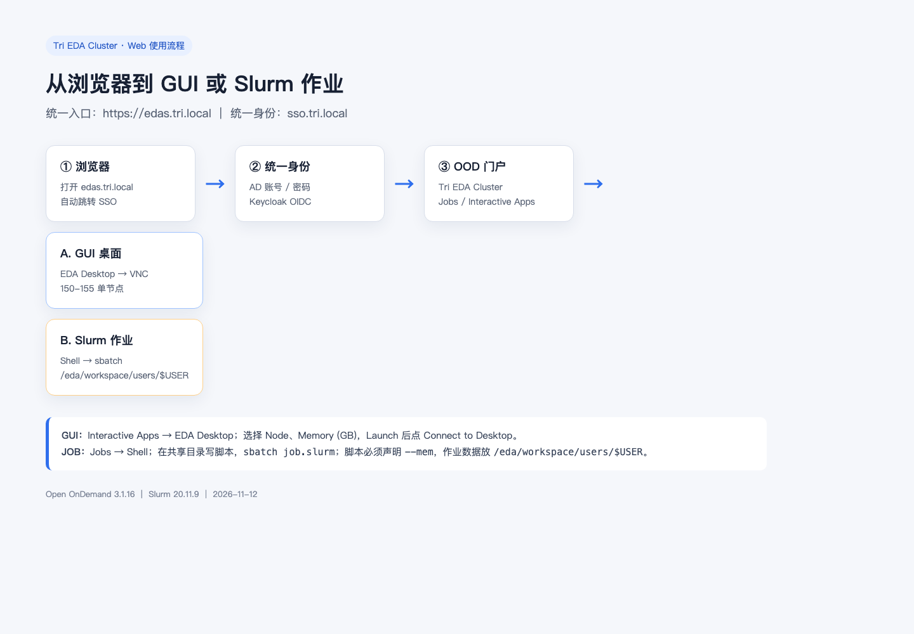
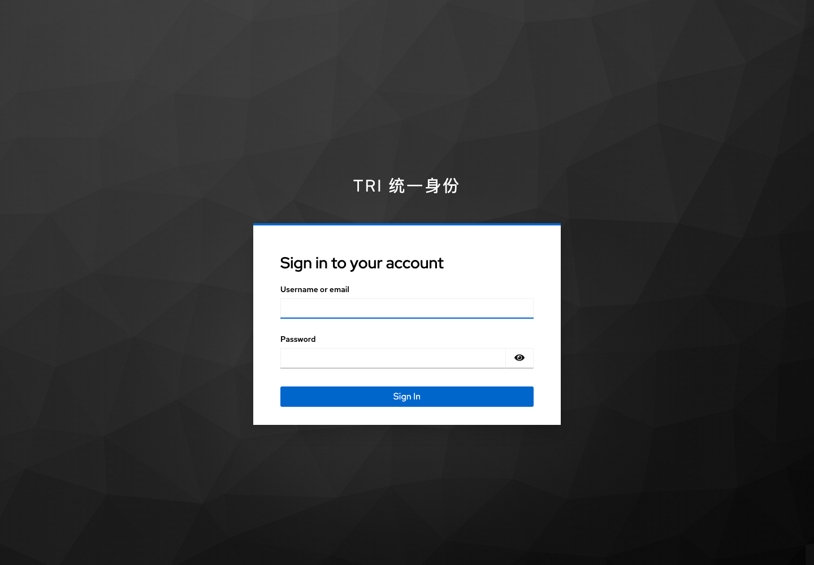
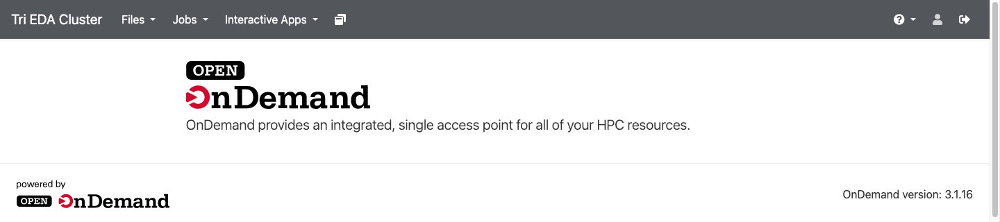
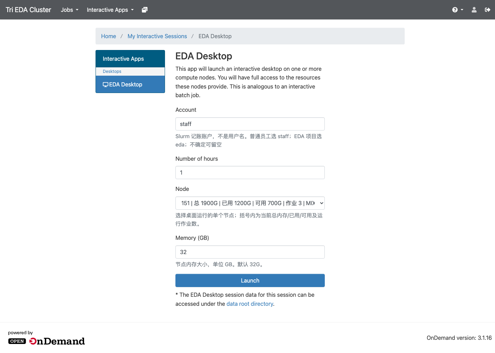
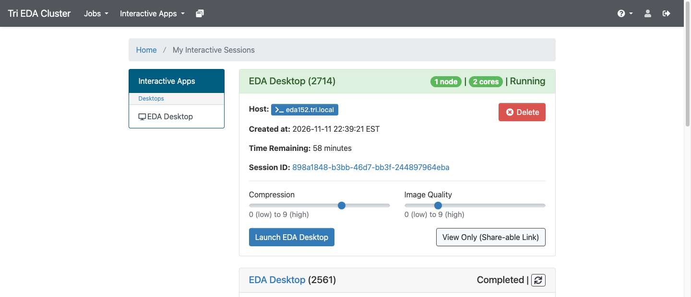
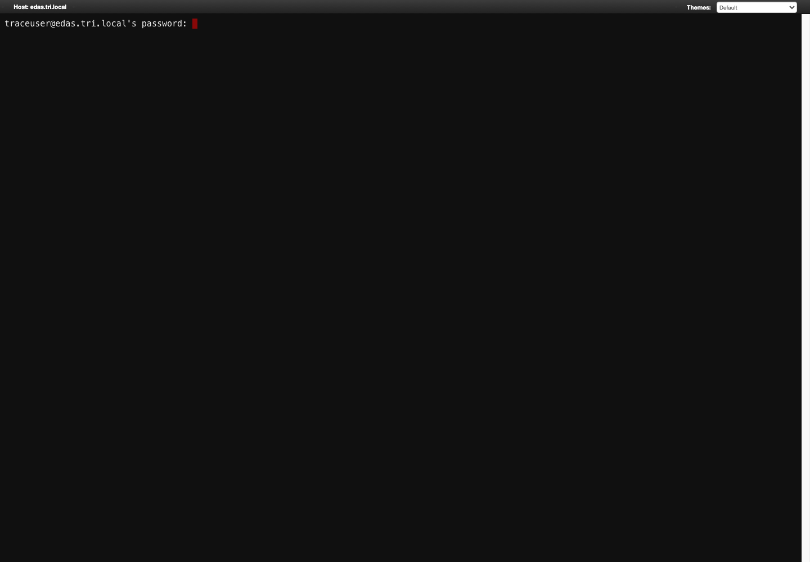

# 通过 Web 登录 OOD 提交 GUI 桌面或 Slurm 作业

> 适用集群：Tri EDA Cluster ｜ OOD 3.1.16 ｜ 更新：2026-11-12
> 访问地址：**https://edas.tri.local**

---

## 0. 整体流程

| 步骤 | 操作 |
|---|---|
| ① | 浏览器打开 https://edas.tri.local |
| ② | 用 AD 域账号完成统一身份认证 |
| ③ | 进入 **Tri EDA Cluster** OOD 门户 |
| ④ | 选择 **GUI 桌面** 或 **Slurm 作业** |

---

## 1. 登录 OOD

### 1.1 打开地址

浏览器输入：

    https://edas.tri.local

会自动跳转到企业统一身份：

    https://sso.tri.local

### 1.2 输入域账号

输入：

- **Username or email**：你的 AD 域账号，例如 zhangsan
- **Password**：域密码

点击 **Sign In**。

### 1.3 进入门户

登录成功后进入 OOD：

页面顶部导航：

    Tri EDA Cluster   Jobs   Interactive Apps

---

## 2. 方式 A：提交 GUI 桌面（EDA Desktop）

适合：

- Cadence Virtuoso / Innovus
- Synopsys Verdi / DVE / ICC2 GUI
- Calibre GUI
- 需要多窗口、鼠标操作的 EDA 工具

### 2.1 打开 EDA Desktop

顶部菜单：

    Interactive Apps → EDA Desktop

### 2.2 填写表单

| 字段 | 说明 | 示例 |
|---|---|---|
| **Number of hours** | 桌面最长运行时间 | 1 |
| **Node** | 选择单个计算节点；下拉框显示实时资源 | 151 |
| **Memory (GB)** | 该节点申请的内存，单位 GB | 32 |

Node 下拉框显示格式：

    151 | 总 1900G | 已用 1200G | 可用 700G | 作业 3 | MIXED

含义：

| 字段 | 含义 |
|---|---|
| 总 | 节点总内存 |
| 已用 | 已被 Slurm 分配的内存 |
| 可用 | 还能分配给新作业的内存 |
| 作业 | 当前节点上运行中的作业数 |
| IDLE / MIXED | 节点空闲 / 部分占用 |

### 2.3 启动

点击 **Launch**。

桌面模式固定：

- **单节点**
- 不需要填写分区
- 不需要填写节点数量

系统自动提交到所选节点：

    Node=151 → 分区 eda15x，节点 172.16.50.151
    Node=150 → 分区 eda，  节点 172.16.50.150

### 2.4 连接桌面

打开：

    My Interactive Sessions

运行中的会话会显示：

- **Running**
- **1 node** / **2 cores**
- **Host**
- **Launch EDA Desktop** 按钮

点击 **Launch EDA Desktop**，浏览器内打开 VNC 桌面。

> 如果状态是 **Completed**，说明该次桌面作业已结束，不能再连接；请重新 Launch。

### 2.5 在桌面里使用 EDA 工具

在桌面中打开终端：

    export PATH=/eda/env/commands/bin:$PATH
    export LM_LICENSE_FILE=27000@172.16.50.121
    export SNPSLMD_LICENSE_FILE=27000@172.16.50.121

    virtuoso &
    # 或
    innovus
    # 或
    verdi &

> 桌面会一直占用所选节点，直到你关闭会话或达到小时数上限。用完请及时在 **My Interactive Sessions** 里 **Delete**。

---

## 3. 方式 B：提交 Slurm 作业（Web Shell）

适合：

- Design Compiler 批处理
- VCS / Xcelium 仿真
- 综合、STA、DRC/LVS 批处理
- 不需要图形界面的长任务

### 3.1 打开 Web Shell

浏览器直接访问：

    https://edas.tri.local/pun/sys/shell

登录后可在 **Jobs → Web Shell** 打开；也可直接访问上述地址。

首次连接可能提示：

    Are you sure you want to continue connecting (yes/no/[fingerprint])?

输入 yes 回车。

如果提示：

    <你的账号>@edas.tri.local's password:

输入你的 **域密码**。

### 3.2 进入共享目录

    mkdir -p /eda/workspace/users/$USER/slurm-logs
    cd /eda/workspace/users/$USER

> 作业文件必须放 /eda/workspace/users/$USER，不要放 /home/$USER。

### 3.3 编写作业脚本

    cat > myjob.slurm <<'EOF'
    #!/bin/bash
    #SBATCH --job-name=myjob
    #SBATCH --partition=eda15x
    #SBATCH --nodes=1
    #SBATCH --ntasks=1
    #SBATCH --cpus-per-task=4
    #SBATCH --mem=32G
    #SBATCH --time=00:30:00
    #SBATCH --account=staff
    #SBATCH --output=/eda/workspace/users/%u/slurm-logs/%x-%j.out
    #SBATCH --error=/eda/workspace/users/%u/slurm-logs/%x-%j.err

    cd "/eda/workspace/users/$USER"

    echo "hostname: $(hostname -f)"
    echo "node: $SLURM_JOB_NODELIST"
    echo "start: $(date)"
    # 你的命令，例如：
    # dc_shell -f synth.tcl
    echo "end: $(date)"
    EOF

### 3.4 提交与查看

    sbatch myjob.slurm
    squeue -u $USER

### 3.5 文件上传（Files）

顶部菜单 **Files → Home Directory** 可上传文件；**Upload 可用，Download 已关闭**。

查看历史：

    sacct -u $USER -S today
    sacct -j <JobID> -o JobID,Partition,State,ExitCode,Elapsed,NodeList

查看输出：

    ls -la /eda/workspace/users/$USER/slurm-logs/
    cat /eda/workspace/users/$USER/slurm-logs/myjob-<JobID>.out

取消：

    scancel <JobID>

---

## 4. GUI 与 JOB 怎么选

| 需求 | 推荐方式 |
|---|---|
| 交互式调试、版图、GUI 工具 | **EDA Desktop** |
| 批量综合/仿真/DRC | **Web Shell + sbatch** |
| 需要看图形但只有少量窗口 | EDA Desktop 或 X11 |
| 长任务、无人值守 | **sbatch** |
| 只想快速跑条命令 | srun -p eda15x --mem=1G --pty bash |

---

## 5. 关键规则

1. **作业数据放共享目录**

       /eda/workspace/users/$USER

   不要放 /home/$USER。

2. **eda15x 作业必须声明内存**

       #SBATCH --mem=32G

   不写会被 job_submit.lua 拒绝。

3. **#SBATCH 里不要写 $USER**

       正确：
       #SBATCH --output=/eda/workspace/users/%u/slurm-logs/%x-%j.out

       错误：$USER 不会展开
       #SBATCH --output=/eda/workspace/users/$USER/slurm-logs/%x-%j.out

4. **输出目录先创建**

       mkdir -p /eda/workspace/users/$USER/slurm-logs

5. **Account 已取消填写**

   Slurm 作业自动使用用户的默认账户（普通员工为 staff）。

---

## 6. 常见问题

### 页面 403 / Blocked host

管理员更换 OOD 域名后旧 PUN 未清理。管理员执行：

    /opt/ood/nginx_stage/sbin/nginx_stage nginx_clean -f

### 提交被拒绝：要求显式指定内存

说明作业没有带 --mem：

    #SBATCH --mem=32G

### EDA Desktop 显示 Completed，没有 Launch 按钮

该次桌面作业已结束：

1. 在 **My Interactive Sessions** 里删除旧卡片
2. 重新 **Interactive Apps → EDA Desktop → Launch**

### 桌面连接黑屏 / 打不开

把会话 ID 和截图发给管理员，并检查：

    /var/log/ondemand-nginx/<用户名>/error.log

以及会话目录下的：

    output.log
    vnc.log
    websockify.log

### 作业输出文件不存在

通常是 --output 的父目录不存在：

    mkdir -p /eda/workspace/users/$USER/slurm-logs

---

## 7. 最简速查

    登录：      https://edas.tri.local
    GUI：       Interactive Apps → EDA Desktop
                Node=151-155, Memory=32, Launch
    连接：      My Interactive Sessions → Launch EDA Desktop
    作业：      https://edas.tri.local/pun/sys/shell
                cd /eda/workspace/users/$USER
                sbatch job.slurm
    查看：      squeue -u $USER
                sacct -u $USER -S today
